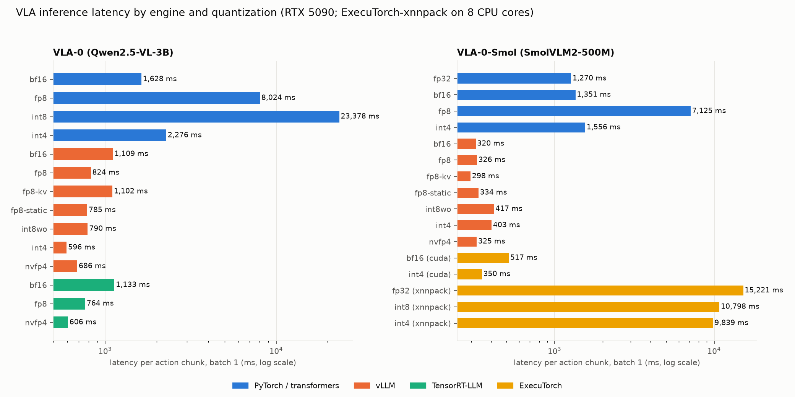
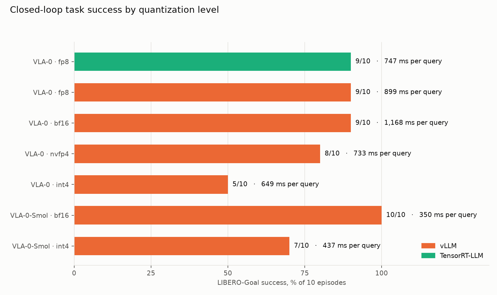
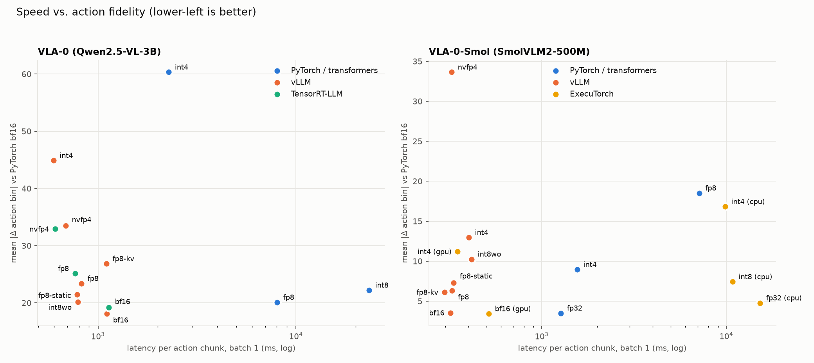

# vla_bench — VLA inference across quantization levels and engines

Companion to `fastlab`/`memlab` (reimplementations) and `libero_sim` (π₀.5 running the
real thing). This directory asks the deployment question: **once you have a trained VLA,
how fast can you run it, with which engine, at which precision, and what does the policy
lose?** Everything here was measured on one machine:

| | |
|---|---|
| GPU | NVIDIA GeForce RTX 5090, 32 GB, Blackwell sm_120, driver 595.99 / CUDA 13.2 |
| CPU | AMD Ryzen 7 9800X3D (8c/16t), 30 GB RAM |
| engines | vLLM 0.33.0 · TensorRT-LLM 1.2.1 (PyTorch backend) · ExecuTorch 1.5.1 (XNNPACK + CUDA/AOTInductor) · PyTorch 2.14 + transformers 5.18 as the reference |
| quantizers | llm-compressor 0.15 (compressed-tensors for vLLM) · NVIDIA ModelOpt 0.37 (for TensorRT-LLM) · torchao 0.18 (PyTorch + ExecuTorch) |
| measured | 2026-11-03 to 2026-11-05 |

## The subject: VLAs that are plain VLMs

vLLM, TensorRT-LLM and ExecuTorch are LLM/VLM engines. They can only serve a VLA whose
action head is the language model's own token stream, which rules out π₀/π₀.5 (flow
matching expert) but exactly fits the **VLA-0** family (Goyal et al., 2025): an
*unmodified* VLM fine-tuned to print its action chunk as integers. Two real, released,
LIBERO-trained policies are benchmarked:

| | VLA-0 | VLA-0-Smol |
|---|---|---|
| checkpoint | [`ankgoyal/vla0-libero`](https://huggingface.co/ankgoyal/vla0-libero) (official, NVIDIA) | [`Robot-Learning-Collective/VLA-0-Smol`](https://huggingface.co/Robot-Learning-Collective/VLA-0-Smol), served from the HF-format conversion [`olegbalakhnov/vla-0-smol-libero-vllm`](https://huggingface.co/olegbalakhnov/vla-0-smol-libero-vllm) |
| backbone | Qwen2.5-VL-3B-Instruct, 3.75 B params | SmolVLM2-500M-Video-Instruct, 0.5 B params |
| inputs | agent + wrist camera, 224² each, tiled into one 448×224 image → 128 image tokens; instruction | agent + wrist camera as two 512² images → 2×64 image tokens; instruction; 8-D proprio state as 8 integers |
| output | 8 steps × 7 dims = 56 integers in [0,1000], ≈208 tokens | 8 × 7 = 56 integers in [0,512), ≈208 tokens |
| reported LIBERO success | 94.7 % avg (paper) | see its project page |
| engine coverage | PyTorch, vLLM, TensorRT-LLM (ExecuTorch cannot export Qwen2.5-VL's dynamic-resolution vision tower / M-RoPE) | PyTorch, vLLM, ExecuTorch CPU+CUDA (TensorRT-LLM has no SmolVLM/Idefics3 support) |

VLA-0's own README lists "TensorRT-LLM integration" and "lower precision deployment
(e.g. INT8)" as open future work; this directory is that experiment.

The input/output contract of each policy (system prompt, chat layout, image crop/tiling,
state and action binning, de-normalisation) is reproduced from the authors' code in
`common/vla0.py` and `common/vla0_smol.py`, so every engine tokenizes the *same string*
and sees the *same pixels*.

## What is measured

The observation set is 120 LIBERO scenes rendered by `prepare_data.sh` (40 tasks × 3
benchmark initial states, after the 10 settling steps every LIBERO policy performs
before its first query). The `core` subset (40 scenes, one per task) is what every
configuration runs; the full set backs the quantization calibration.

Per configuration (`engines/base.py`):

* **latency** — batch 1, one observation at a time, wall clock around the engine call:
  observation in → 56 integers out. This is the robot's control period. VLA-0 queries
  the model *every* environment step.
* **throughput** — the same observations as one batch of 8 and 32 (serving many robots
  or ensembling), obs/s and output tok/s.
* **fidelity** — the 56 predicted bins against the PyTorch bf16 reference *and* against
  the same engine's own bf16 run: mean absolute error in bins (1000 or 512 per full
  range), fraction of values within 10 bins, first-timestep error, gripper sign
  agreement, and the error in the environment's action units.
* **closed-loop success** (`eval_closed_loop.sh`) — the LIBERO simulator driving a
  served policy with each paper's exact protocol (query every step, temporal ensemble of
  8 chunks), for a subset of configurations.

Quantization levels (names as used in the results):

| level | vLLM | TensorRT-LLM | ExecuTorch | PyTorch (torchao, eager) |
|---|---|---|---|---|
| bf16 | reference | reference | fp32 (XNNPACK, CPU) / bf16 (CUDA) | reference |
| fp8 | `fp8`: on-the-fly W8A8, dynamic activation scales · `fp8-static`: llm-compressor, static scales · `fp8-kv`: bf16 weights + FP8 KV cache | ModelOpt FP8 W8A8, with and without FP8 KV cache | n/a (no FP8 kernels in XNNPACK or the CUDA backend) | Float8 dynamic W8A8 |
| int8 | `int8wo`: llm-compressor GPTQ W8A16 (weight-only). W8A8 is **rejected on SM120** | not offered for this model | `int8`: 8da8w (XNNPACK) | Int8 dynamic W8A8 |
| int4 | llm-compressor W4A16: AWQ g128 (VLA-0), GPTQ g32 (VLA-0-Smol) | ModelOpt INT4-AWQ is **rejected on SM120** | `int4`: 8da4w g32 (XNNPACK) / 4w tile-packed (CUDA) | Int4 weight-only g128 (tinygemm) |
| nvfp4 | llm-compressor NVFP4 W4A4 | ModelOpt NVFP4 W4A4 | n/a | n/a |

Only the language model's linear layers are quantized; the vision tower, the projector
and the LM head stay bf16 in every recipe (the convention of ModelOpt, llm-compressor's
VLM examples and the quantized-VLM literature). Calibration data for the static recipes
are the benchmark's own LIBERO observations, each prompt completed with the bf16 model's
action text, so the activation statistics cover both the image prefill and the
digits-only decode regime.

## Layout

```
common/        vla0.py, vla0_smol.py (policy contracts), contracts.py (engine-facing API)
engines/       base.py (benchmark loop) · run_hf.py · run_vllm.py · run_trtllm.py ·
               run_executorch.py · export_executorch.py · serve.py (HTTP policy server)
quantize/      llmc_quantize.py (llm-compressor) · modelopt_quantize.py (ModelOpt) ·
               prebuild_flashinfer.py (one-off kernel build, see below)
patches/       patch_trtllm_nvml.py (one-line TensorRT-LLM fix, see below)
phases/        the run lists executed by run_matrix.sh, in order
run_matrix.sh  sequential job runner with the memory guard (shim/ninja caps compile parallelism)
prepare_data.* render the observation set (LIBERO, Python 3.8 venv from ../libero_sim)
eval_closed_loop.*, run_closed_loop.sh   LIBERO closed-loop success against engines/serve.py
report.py, make_tables.py, figures.py   results/*.json -> results/summary.md, tables.md, figures/
.venvs/        one venv per engine (vllm, trtllm, executorch, quant); not in git
```

One venv per engine because their torch pins conflict (vLLM 0.33 → torch 2.14, TensorRT-LLM
1.2.1 → torch 2.9.1, ExecuTorch 1.5.1 → torch 2.15). `logs/install_*.log` record exactly
what was installed.

## Things that had to be worked around

Recorded because each cost real time and none is obvious from the engines' docs.

* **Host memory, not VRAM, is the binding constraint on this box.** 30 GB RAM, ~10 GB of it
  the desktop. vLLM's first use of an FP8/NVFP4 checkpoint on SM120 makes FlashInfer JIT-compile
  its CUTLASS GEMM (29 nvcc units, 6–10 GB of host RAM *each*); stacked on an engine process
  that already holds ~10 GB this pushed the machine into the OOM killer three times.
  `run_matrix.sh` therefore runs every job alone in a systemd scope with `MemoryMax` (12 GB
  default) and no swap, at `oom_score_adj=1000`, gated on free RAM and an idle GPU, with a
  watchdog; compiles are forced to one process (`shim/ninja`), and
  `quantize/prebuild_flashinfer.py` builds the kernels once, outside the engine.
* **TensorRT-LLM without root.** Its runtime links Open MPI; the PyPI `openmpi` wheel supplies
  `libmpi.so.40` (`trtllm_env.sh`). With that MPI, `MPI_Comm_spawn` (TensorRT-LLM's default way
  to start its worker) never returns, so LLM-API scripts go through `trtllm_launch.sh`
  (`mpirun -n 1 trtllm-llmapi-launch python ...`). TensorRT-LLM 1.2.1 also passes an NVML struct
  by value in `confidential_compute_enabled()` and segfaults its executor with nvidia-ml-py
  13.615; `patches/patch_trtllm_nvml.py` fixes the call.
* **ExecuTorch.** The CUDA backend ships in `executorch==1.5.1+cu130` on the PyTorch index (the
  PyPI wheel is CPU-only). `optimum-cli export executorch` cannot export SmolVLM as is: its task
  loader uses `AutoModelForPreTraining` (no SmolVLM mapping) and SmolVLM's vision tower filters
  padding images with data-dependent indexing that `torch.export` rejects.
  `engines/export_executorch.py` loads with `AutoModelForImageTextToText` and exports the vision
  tower on a fixed 512×512 input (verified equal to the stock forward). The faster custom-SDPA /
  custom-KV-cache export builds but cannot run: no runtime in the wheel registers
  `llama::custom_sdpa` / `llama::update_cache`.
* **Quantizers.** llm-compressor's SmoothQuant and AWQ default mappings do not resolve on SmolVLM
  (GPTQ used), and its weight group size must divide the hidden size (960 → 32). torchao 0.18's
  default INT4 packing needs the `mslk` package; the tinygemm packing is used.
* **What SM120 (consumer Blackwell) refuses outright** is listed in `results/notes_unsupported.md`.

## Running

```bash
./prepare_data.sh                         # observations -> data/
python3 patches/patch_trtllm_nvml.py      # once, after creating the trtllm venv
./run_matrix.sh phases/phase1.txt         # references: bf16 / fp8 on PyTorch + vLLM
./run_matrix.sh phases/phase2.txt         # kernel pre-build, llm-compressor levels on vLLM, torchao on PyTorch
./run_matrix.sh phases/phase3.txt         # TensorRT-LLM with ModelOpt checkpoints
./run_matrix.sh phases/phase4.txt         # ExecuTorch exports (XNNPACK, CUDA) and runs
./run_matrix.sh phases/phase5.txt         # closed-loop LIBERO for the key configurations
.venvs/vllm/bin/python report.py && .venvs/vllm/bin/python make_tables.py
(cd .. && uv run --frozen python vla_bench/figures.py)
```

Each line of a phase file is `name | command [| mem=14G]`. A job whose `results/<name>.json`
(or build product) already exists is skipped, so every phase is resumable; as checked in, all of
them are no-ops. For long runs, start the runner as its own unit so it does not die with the
editor session: `systemd-run --user --unit=vla-bench ./run_matrix.sh phases/phaseN.txt`.

## Results

Batch-1 latency is one full action chunk (two cameras + instruction in, 56 integers out, ≈208
generated tokens). "Δ bins" is the mean absolute difference of the 56 predicted bins from the
reference run. "Closed-loop success" is LIBERO-Goal, 10 tasks × 1 initial state.



### VLA-0 (Qwen2.5-VL-3B, 3.75 B parameters, bins 0–1000)

| engine | level | checkpoint GB | latency ms (b=1) | Hz | tok/s | obs/s b=8 | obs/s b=32 | well-formed | Δ bins vs PyTorch bf16 | Δ bins vs own bf16 | within 10 bins | closed-loop success |
|---|---|---|---|---|---|---|---|---|---|---|---|---|
| PyTorch (eager) | bf16 | 7.51 | 1,628 | 0.61 | 127 | 3.2 | 7.1 | 100% | – | – | – | – |
| PyTorch (eager) | fp8 | 7.51 | 8,024 | 0.12 | 26 | 0.7 | 2.6 | 100% | 20.1 | – | 57% | – |
| PyTorch (eager) | int8 | 7.51 | 23,378 | 0.04 | 9 | 0.2 | 0.8 | 100% | 22.2 | – | 57% | – |
| PyTorch (eager) | int4 | 7.51 | 2,276 | 0.44 | 92 | 2.5 | 5.3 | 70% | 60.3 | – | 46% | – |
| vLLM | bf16 | 7.51 | 1,109 | 0.90 | 188 | 5.6 | 23.6 | 100% | 18.1 | – | 65% | 90% (9/10) |
| vLLM | fp8 | 7.51 | 824 | 1.21 | 253 | 9.4 | 35.2 | 100% | 23.4 | 24.8 | 56% | 90% (9/10) |
| vLLM | fp8-static | 4.73 | 785 | 1.27 | 265 | 10.0 | 33.8 | 100% | 21.5 | 24.4 | 56% | – |
| vLLM | fp8-kv | 7.51 | 1,102 | 0.91 | 191 | 5.7 | 22.7 | 92% | 26.9 | 28.4 | 54% | – |
| vLLM | int8wo | 4.78 | 790 | 1.27 | 264 | 9.6 | 32.6 | 100% | 20.2 | 12.2 | 63% | – |
| vLLM | int4 | 3.39 | 596 | 1.68 | 350 | 12.6 | 39.1 | 100% | 44.9 | 43.3 | 48% | 50% (5/10) |
| vLLM | nvfp4 | 3.52 | 686 | 1.46 | 304 | 10.2 | 42.3 | 98% | 33.5 | 35.9 | 46% | 80% (8/10) |
| TensorRT-LLM | bf16 | 7.51 | 1,133 | 0.88 | 183 | 4.8 | 13.4 | 100% | 19.2 | – | 62% | – |
| TensorRT-LLM | fp8 | 4.73 | 764 | 1.31 | 271 | 7.5 | 16.0 | 100% | 25.1 | 26.8 | 57% | 90% (9/10) |
| TensorRT-LLM | fp8 + FP8 KV | 4.73 | 785 | 1.27 | 267 | 6.3 | 14.7 | 95% | 32.7 | 30.1 | 50% | – |
| TensorRT-LLM | nvfp4 | 3.52 | 606 | 1.65 | 342 | 7.7 | 16.4 | 98% | 32.9 | 35.7 | 46% | – |

### VLA-0-Smol (SmolVLM2-500M, bins 0–511)

| engine | level | checkpoint GB | latency ms (b=1) | Hz | tok/s | obs/s b=8 | obs/s b=32 | well-formed | Δ bins vs PyTorch bf16 | Δ bins vs own bf16 | within 10 bins | closed-loop success |
|---|---|---|---|---|---|---|---|---|---|---|---|---|
| PyTorch (eager) | fp32 | 2.03 | 1,270 | 0.79 | 164 | 4.7 | 11.4 | 100% | 3.5 | – | 88% | – |
| PyTorch (eager) | bf16 | 2.03 | 1,351 | 0.74 | 154 | 4.7 | 16.5 | 100% | – | – | – | – |
| PyTorch (eager) | fp8 | 2.03 | 7,125 | 0.14 | 29 | 0.4 | 1.7 | 95% | 18.5 | – | 74% | – |
| PyTorch (eager) | int4 | 2.03 | 1,556 | 0.64 | 134 | 4.2 | 14.7 | 100% | 9.0 | – | 70% | – |
| vLLM | bf16 | 2.03 | 320 | 3.12 | 652 | 20.9 | 70.6 | 100% | 3.6 | – | 89% | 100% (10/10) |
| vLLM | fp8 | 2.03 | 326 | 3.07 | 641 | 22.9 | 77.5 | 100% | 6.3 | 6.6 | 78% | – |
| vLLM | fp8-static | 0.70 | 334 | 3.00 | 627 | 24.7 | 82.2 | 100% | 7.3 | 7.8 | 75% | – |
| vLLM | fp8-kv | 2.03 | 298 | 3.36 | 702 | 23.1 | 83.3 | 100% | 6.1 | 6.5 | 79% | – |
| vLLM | int8wo | 0.72 | 417 | 2.40 | 501 | 17.8 | 49.2 | 98% | 10.3 | 9.3 | 84% | – |
| vLLM | int4 | 0.56 | 403 | 2.48 | 519 | 18.5 | 49.8 | 98% | 13.0 | 12.7 | 74% | 70% (7/10) |
| vLLM | nvfp4 | 0.56 | 325 | 3.08 | 636 | 23.9 | 79.8 | 90% | 33.7 | 33.3 | 63% | – |
| ExecuTorch XNNPACK (CPU) | fp32 | 2.03 | 15,221 | 0.07 | 14 | – | – | 100% | 4.8 | – | 84% | – |
| ExecuTorch XNNPACK (CPU) | int8 | 0.95 | 10,798 | 0.09 | 19 | – | – | 100% | 7.4 | – | 75% | – |
| ExecuTorch XNNPACK (CPU) | int4 | 0.79 | 9,839 | 0.10 | 21 | – | – | 98% | 16.8 | – | 62% | – |
| ExecuTorch CUDA | bf16 | 1.02 | 517 | 1.94 | 402 | – | – | 100% | 3.4 | – | 88% | – |
| ExecuTorch CUDA | int4 | 0.55 | 350 | 2.85 | 593 | – | – | 100% | 11.2 | 10.9 | 66% | – |

ExecuTorch XNNPACK fp32 was run on 20 of the 40 observations (15 s each); every other row uses all 40.
ExecuTorch has no batch dimension in this export, so its throughput columns are empty.

### Closed loop

| model | engine | level | success | mean steps | policy latency ms | malformed outputs |
|---|---|---|---|---|---|---|
| vla0 | TensorRT-LLM | fp8 | 90% (9/10) | 123 | 747 | 9 |
| vla0 | vLLM | bf16 | 90% (9/10) | 138 | 1,168 | 11 |
| vla0 | vLLM | fp8 | 90% (9/10) | 149 | 899 | 6 |
| vla0 | vLLM | int4 | 50% (5/10) | 200 | 649 | 123 |
| vla0 | vLLM | nvfp4 | 80% (8/10) | 170 | 733 | 47 |
| vla0-smol | vLLM | bf16 | 100% (10/10) | 135 | 350 | 0 |
| vla0-smol | vLLM | int4 | 70% (7/10) | 171 | 437 | 8 |



`results/summary.md` has every column (p90, throughput in tokens, per-dimension error, the
action-unit error); `results/*.json` hold each run's raw predictions.

### What the numbers say

**At batch 1 the precision matters more than the engine.** vLLM and TensorRT-LLM land on the
same number at bf16 (1,109 vs 1,133 ms, ≈185 tok/s). Two independent engines agreeing, and
latency then falling with the size of the weights, is what a memory-bandwidth limit looks like:
each of the 208 decode steps has to read 7.5 GB of weights. Both engines beat eager PyTorch by
1.45×, most plausibly the overhead of `generate`'s Python loop (not profiled here).
What moves the wall is making the weights smaller: 8-bit weights give 1.35–1.5×, 4-bit
1.6–1.9×. The gain is sub-linear in bits because the vision tower, embeddings and LM head stay
bf16 and the per-token fixed cost does not shrink.

**FP8 is free; 4-bit is not, and which 4-bit matters.** FP8 kept the reference's 9/10 in closed
loop on both engines while cutting the control period from 1.17 s to 0.75–0.90 s. NVFP4 (W4A4,
Blackwell's native format) reached 8/10 at 0.73 s. INT4-AWQ (W4A16) was the fastest row on vLLM
(596 ms) but fell to 5/10 and produced 123 malformed action strings along the way. The offline
Δ-bins metric ranked the levels in the same order before any robot moved: 12, 24, 36 and 43
bins away from the engine's own bf16 run for int8wo, fp8, nvfp4 and int4. For scale, bf16 on
vLLM or TensorRT-LLM already differs from bf16 on PyTorch by 18–19 bins. It is a usable cheap
screen. Ten episodes per row is a small sample: 5/10 vs 9/10 is
suggestive, not significant (Fisher exact p ≈ 0.14).

**Weight-only INT8 is the most faithful quantized level** on VLA-0 (12 bins from its own bf16
run, below the cross-engine noise) at FP8 speed. It was not run in closed loop.

**An FP8 KV cache buys nothing for this workload and costs correctness.** The context never exceeds ≈430
tokens, so the cache is tiny; latency is unchanged (1,102 vs 1,109 ms on vLLM, 785 vs 764 ms on
TensorRT-LLM) and it is the only 8-bit option that produced malformed outputs (92–95 %
well-formed).

**For serving many robots, vLLM batches better as configured here.** At batch 32 it reaches
24–42 observations/s against 13–16 for TensorRT-LLM's LLM API. TensorRT-LLM's batching was not
tuned beyond `max_batch_size`, so read this as "out of the box".

**A 500 M-parameter VLA should not be quantized for speed on a desktop GPU.** VLA-0-Smol runs at
320 ms in bf16 on vLLM and every quantized level lands between 298 and 417 ms: with 1 GB of
weights the model is no longer bandwidth-bound and per-token overhead dominates. Quantization
still costs accuracy (int4: 7/10 vs 10/10 in closed loop; NVFP4: 33 bins of 512 off and 10 % of
outputs malformed). Its only remaining use at this size is memory.

**ExecuTorch.** The CUDA (AOTInductor) backend is competitive for VLA-0-Smol: 517 ms at bf16
(1.6× vLLM's 320 ms) and 350 ms at int4 (ahead of vLLM's own int4 at 403 ms), even though the
decode loop here is driven from Python, from a 9 MB program plus a 0.5–1 GB weight blob. On the CPU (XNNPACK, 8 threads of a 9800X3D) the same
policy needs 15.2 s per chunk in fp32 and 9.8 s at int4, 42–67 ms per token, 30–50× slower
than the GPU. That is not a control rate. On a CPU the binding cost is the action
representation itself: 56 integers spelled out as ≈208 tokens. `fastlab` in this repo shows
FAST encoding a 700-value chunk (50 steps × 14 dims) in about 90 tokens; applied to this
56-value chunk the same idea should cut the token count several-fold. That was not measured here.

**Quantization without an engine is slower than no quantization.** torchao's dynamic FP8/INT8 in
eager PyTorch re-quantize activations in Python on every call (8.0 s and 23.4 s per chunk on
VLA-0, against 1.6 s for bf16). Its uncalibrated INT4 keeps the speed (2.3 s) but only 70 % of
outputs are well-formed, against 100 % for calibrated AWQ on vLLM.



### What this GPU refuses to run

| model | engine | quant | outcome |
|---|---|---|---|
| vla0, vla0-smol | vLLM 0.33.0 | int8 (W8A8, llm-compressor GPTQ) | checkpoint builds, engine refuses to start: `dispatch_scaled_mm ... Int8 not supported on SM120. Use FP8 quantization instead, or run on older arch (SM < 100)` |
| vla0 | TensorRT-LLM 1.2.1 | int4 (W4A16 AWQ, ModelOpt) | checkpoint builds, executor fails: `Not Implemented: SM120 GEMM only supports nvfp4. (cutlass_heuristic.cpp:566)` |
| vla0-smol | PyTorch + torchao 0.18 eager | int8 (W8A8 dynamic) | ran at 220-270 s per chunk with degenerate action strings; stopped by hand after 6 observations (see notes_vla0-smol__hf__int8.txt) |
| vla0-smol | llm-compressor 0.15 | int4 via AWQ | `AWQ needs to match a single smoothlayer for each mapping`: default mappings do not resolve on SmolVLM's module tree; GPTQ W4A16 (group 32) used instead |
| vla0 | ExecuTorch 1.5.1 | any | Qwen2.5-VL is not exportable: optimum-executorch's multimodal path needs a single non-text modality and a fixed-shape vision encoder; Qwen2.5-VL has dynamic-resolution windowed attention and M-RoPE |
| vla0-smol | TensorRT-LLM 1.2.1 | any | SmolVLM / Idefics3 is not in TensorRT-LLM's supported multimodal architectures |
| vla0-smol | ExecuTorch 1.5.1 (prebuilt wheel) | custom-SDPA / custom-KV-cache exports | export succeeds, but neither the portable Python bindings nor the bundled C++ `MultimodalRunner` register `llama::custom_sdpa.out` / `llama::update_cache.out` ("96 instructions don't have corresponding operator registered"); needs a source-built runtime. The standard static-cache export is benchmarked instead |

### Limits of this benchmark

* One machine, one GPU. Latencies are means over 40 observations (the first policy query of 40
  LIBERO tasks); states later in an episode were only exercised in the closed-loop runs.
* Closed loop is 10 episodes per configuration on one suite. It separates "works" from "breaks",
  not 90 % from 80 %.
* "fp8" or "int4" is not bit-identical across engines: each engine has its own quantizer
  (llm-compressor, ModelOpt, torchao) and recipe, listed under *What is measured*.
* Rows first measured on Nov 3 ran beside a heavy CPU workload and were re-measured on Nov 4–5 on
  a quiet machine; the originals are in `results/nov3_loaded/` (ignored by git).
* ExecuTorch numbers use the Python bindings and the standard static-cache export; a source-built
  runtime with the LLM custom kernels would be faster on the CPU.
* TensorRT-LLM here is its PyTorch backend through the LLM API, not a serialized TensorRT engine.
